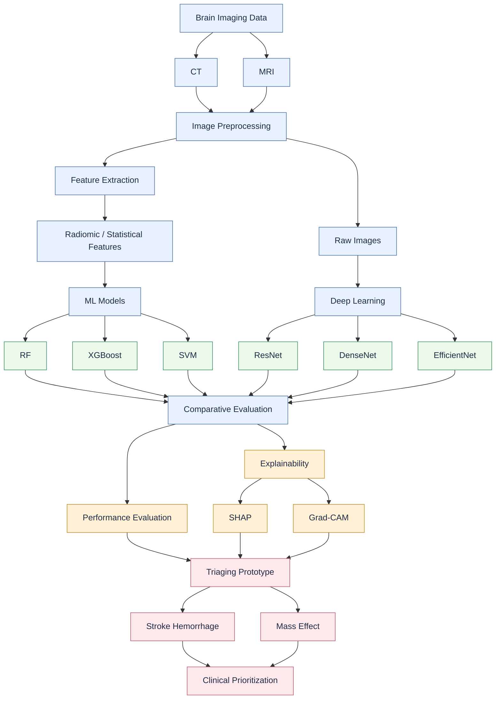

# Brain Imaging Triage Workflow

This Mermaid version recreates the architecture shown in the provided diagram for a brain imaging triage system using CT/MRI data, preprocessing, ML and deep learning models, evaluation, explainability, and clinical prioritization.
